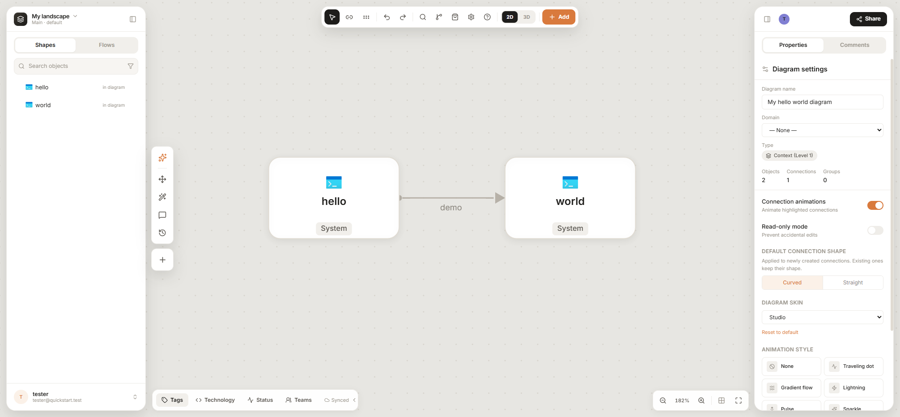
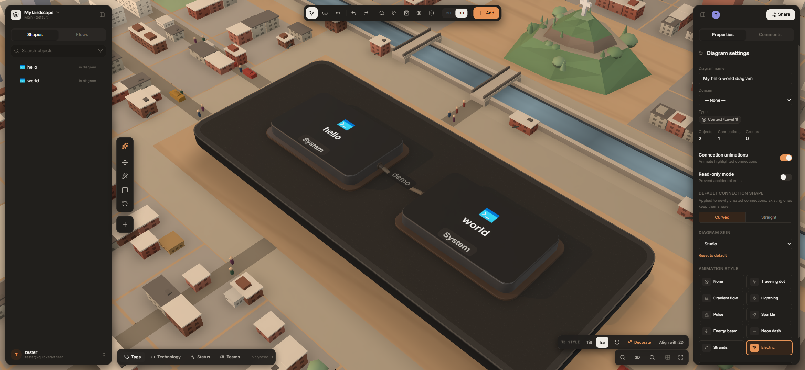
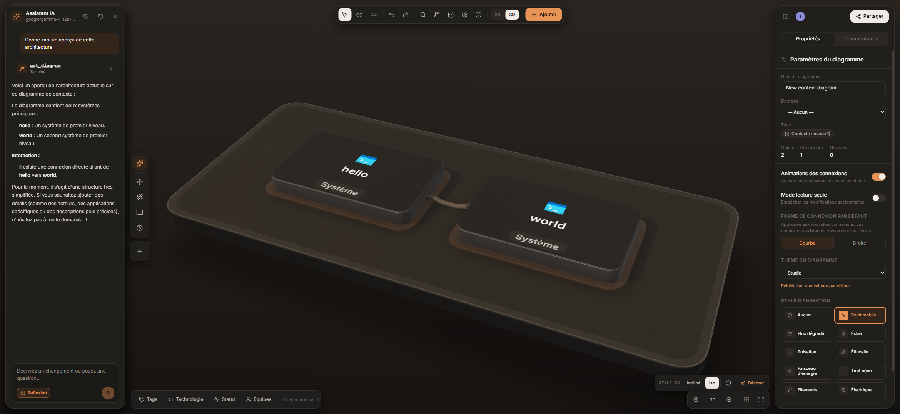
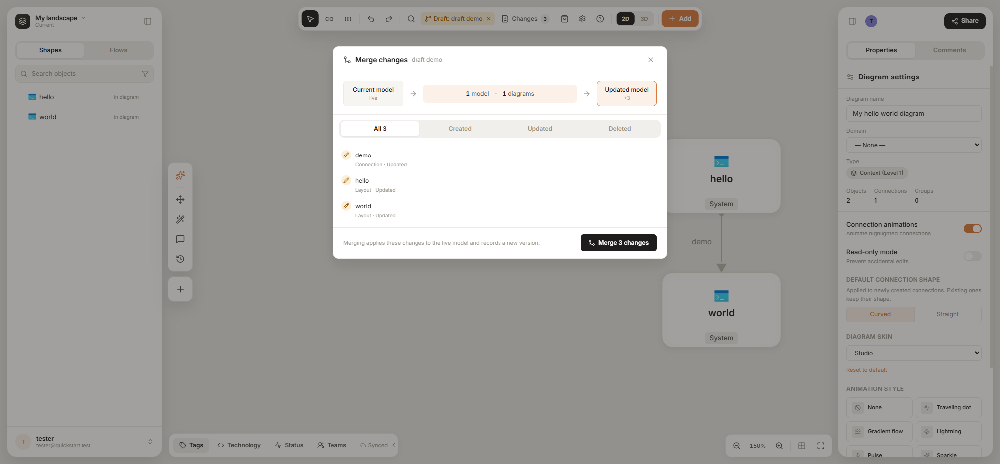
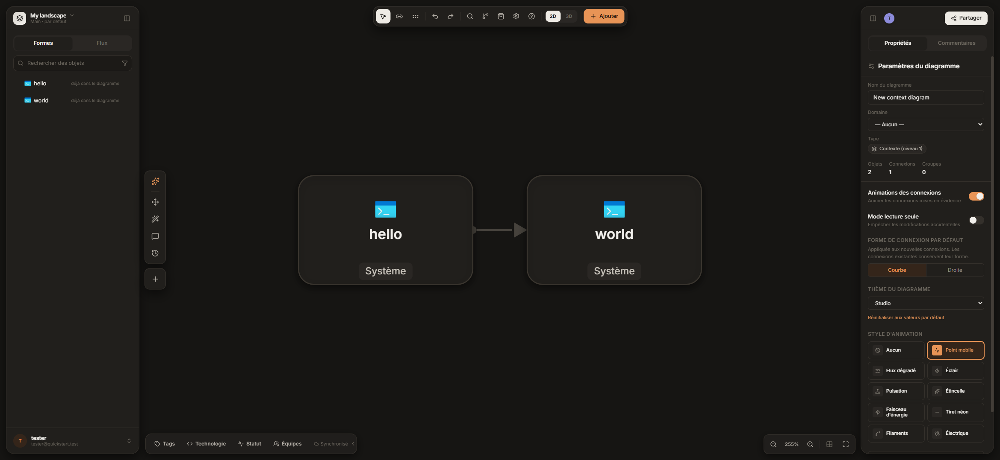

<p align="center">
  
</p>

<p align="center">
  <strong>Architecture clarity that moves teams forward.</strong><br>
  Collaborative C4 modelling and diagramming — one trusted model instead of scattered drawings.
</p>

<p align="center">
  <a href="https://maplespire.ca">Website</a> ·
  <a href="docs/getting-started.md">Get started</a> ·
  <a href="docs/running-locally.md">Develop locally</a> ·
  <a href="#sponsors">Sponsors</a> ·
  <a href="#governance">Governance</a> ·
  <a href="#license">License</a>
</p>

<p align="center">
  
</p>

---

## Why MapleSpire

Architecture diagrams rot. They live in slides and wikis, each one a slightly
different copy of the truth, and nobody knows which one is current.

MapleSpire keeps **one model** of your systems — people, software systems,
containers, components and the relationships between them — and every diagram
is a **view** of that model. Rename a service once and every diagram, table and
export follows. Move between levels of detail with a click, see who depends on
what, and keep the decisions that shaped it right next to it.

## What you can do with it

**Model, not just draw**
- C4 modelling: System Context → Container → Component, with drill-down between levels
- A fast canvas editor with automatic layout (ELK) and readable edge routing
- Model Objects, Connections and Dependencies pages: the whole model as searchable tables
- Read-only Model Viewer in 2D or an interactive **3D** board

**Work together**
- Real-time collaboration on the same diagram, with presence and comments
- **Offline-first**: keep working when the server is down; changes sync back when it returns (Automerge CRDT)
- Drafts: fork the model, propose changes, review a three-way diff, then merge
- Architecture Decision Records linked to the elements they affect

**Govern and share**
- Organisations, teams and role-based access control; single sign-on with Google and Microsoft Entra ID
- Tags, technology catalogue with icons, reference-integrity checks
- Interactive read-only share links (public, organisation or email-domain audience), pinned to a version if you want
- Import from **Structurizr DSL**; export to JSON, CSV, PDF, Markdown, HTML, Structurizr, Mermaid, SVG and PNG

**Extend it**
- AI assistant with your own provider key (OpenAI, Anthropic, Google, OpenAI-compatible, LM Studio) and an **MCP server** so external agents can read and edit the model
- Theme plugins through a sandboxed Theme SDK
- English and French interface

**Run it yourself**
- Three containers and two commands to try the whole application locally
- Production add-ons — monitoring, alerting, backup drills, multi-cell sync and cloud deployment kits — documented for [sponsors](#going-further-production-add-ons)

## Screenshots

<table>
  <tr>
    <td width="50%"></td>
    <td width="50%"></td>
  </tr>
  <tr>
    <td><b>3D board</b> — any diagram becomes an interactive 3D view, with optional scenery.</td>
    <td><b>AI assistant</b> — ask about or edit the model with your own provider, here a local model (French interface).</td>
  </tr>
  <tr>
    <td></td>
    <td></td>
  </tr>
  <tr>
    <td><b>Drafts</b> — propose changes on a fork of the model, review them, then merge.</td>
    <td><b>Dark mode</b> — light, dark or system appearance, in English or French.</td>
  </tr>
</table>

## Quick start

```bash
git clone https://github.com/MapleSpire/maplespire.git
cd maplespire
node scripts/init-env.mjs                                # creates .env and generates secrets
docker compose -f compose.quickstart.yml up -d --build   # PostgreSQL + API + web
```

Open **http://localhost:8088** and create your account. The step-by-step guide —
first administrator, confirming your email, settings and troubleshooting — is
**[docs/getting-started.md](docs/getting-started.md)**.

To work on the code with hot reload (no Docker needed):

```bash
npm install
cd server && npm install && cd ..
npm run dev:local        # embedded Postgres + API + Vite on http://localhost:5173
```

See [docs/running-locally.md](docs/running-locally.md).

## How it works

```
 Browser (React + canvas, IndexedDB)
     │  offline edits kept locally, synced when the server is reachable
     ▼
   nginx ── REST + Automerge WebSocket ──►  API (Node)  ──►  PostgreSQL
                                                              Automerge documents (source of truth)
                                                              + rebuildable read model
```

- **Automerge documents are authoritative**; the PostgreSQL read model is a
  cache that can always be rebuilt from them.
- The quickstart runs a single API process. At scale, workspaces are spread
  over several **sync cells**: each workspace is owned by one cell at a time
  through a Redis lease, and an owner-aware router sends every WebSocket
  straight to that cell (see [Going further](#going-further-production-add-ons)).

| Area | Where |
|---|---|
| Web client (Vite, React, TypeScript) | [`src/`](src) — canvas in `src/canvas/`, layout in `src/lib/layout/` |
| Server (Node, Express, Automerge Repo) | [`server/`](server) |
| Docker images and nginx | [`docker/`](docker), [`server/Dockerfile`](server/Dockerfile) |
| Monitoring and compose benches | [`infra/`](infra) |
| Documentation | [`docs/`](docs) |

Architecture and every server setting: [docs/architecture-and-configuration.md](docs/architecture-and-configuration.md).

## Going further: production add-ons

Everything in this repository is free and open source, and the quickstart runs
the complete application. When you take MapleSpire to production, you can add
around it the same pieces that run the public demo:

| Add-on | What it gives you |
|---|---|
| **Second sync cell + owner-aware WebSocket router + Redis leases** | Failover: a standby cell takes over a workspace when its owner stops, and every WebSocket goes straight to the owning cell |
| **Prometheus** alert rules and **Grafana** dashboards | Health of the API, read model, sync cells, Redis and backups at a glance |
| **Alertmanager** paging | Email pages and an external heartbeat, so an outage wakes someone up |
| **Backup-and-restore drill** | Scheduled backups that are restored into an isolated database and booted, to prove they actually work |
| **Cloudflare tunnel** | Publish the stack without opening an inbound port |

### Production deployment kits

The production-shaped Compose file (`compose.maplespire.yml`) and the
monitoring configuration (`infra/monitoring/`) are in this repository. The
guides to configure, run and operate them, plus the managed-cloud and
Kubernetes kits, are in the private **MapleSpire sponsor kit**, available by
[sponsoring the project on GitHub](https://github.com/sponsors/MapleSpire):

- the production stack guide for `compose.maplespire.yml`;
- operations runbooks: sync cells and routing, backups and restore drills,
  alerting (email pages and external heartbeat), security checklist;
- infrastructure as code for **AWS** (CDK: ECS Fargate, Aurora PostgreSQL, ElastiCache, CloudFront);
- **Azure** and **portable Kubernetes** modules (Terraform: AKS, EKS, GKE, OpenShift);
- the matching deployment pipeline and production guides — managed Redis,
  capacity and scaling, WebSocket fan-out, Redis observability and rotation.

Sponsorship funds the development of MapleSpire.

## Sponsors

MapleSpire is made possible by its [GitHub sponsors](https://github.com/sponsors/MapleSpire).
Thank you to everyone who supports the project — every sponsor is listed on the
[sponsors page](https://github.com/sponsors/MapleSpire).

### Business sponsors

<!--
  One logo per Business sponsor, max 200 px wide, linked to the sponsor's site,
  in the order they joined. Logos are requested through the "Sponsor logo"
  issue in MapleSpire/maplespire-sponsor-kit.
  Example:
  <a href="https://example.com"></a>
-->

*Your company logo here —
[become a Business sponsor](https://github.com/sponsors/MapleSpire).*

## Governance

MapleSpire is an open-source project stewarded by the **[MapleSpire](https://github.com/MapleSpire)
organisation** on GitHub.

- **Maintainers.** The project is led by its founding maintainer, who has the
  final say on the roadmap, releases and what gets merged. Regular contributors
  may be invited to become maintainers.
- **How decisions are made.** Proposals start as GitHub issues or discussions.
  Significant changes (architecture, data model, sync protocol, licensing) are
  discussed in the open before code is written, and the reasoning is kept with
  the decision.
- **Contributions.** Pull requests are welcome — see [CONTRIBUTING.md](CONTRIBUTING.md).
  Every change goes through review and the automated checks before it is merged.
  Commits must be signed off under the [Developer Certificate of Origin](https://developercertificate.org/)
  (`git commit -s`) so that we are sure to have the right to distribute the code
  submitted; a GitHub check (**DCO**) verifies it on every pull request.
- **Security.** Please do not open public issues for vulnerabilities — see [SECURITY.md](SECURITY.md).
- **Website.** The marketing site lives in its own repository,
  [MapleSpire/maplespire-website](https://github.com/MapleSpire/maplespire-website),
  and is published at **[maplespire.ca](https://maplespire.ca)**.

## License

MapleSpire is released under the **[GNU Affero General Public License v3.0 or later](LICENSE)**
(AGPL-3.0-or-later).

You may use, study, modify and redistribute it — including commercially and as
a hosted service — provided that you publish your modifications under the same
license and offer the corresponding source code to the users who interact with
a modified version over a network.

---

<details>
<summary><strong>En français</strong></summary>

**MapleSpire** est un outil collaboratif de modélisation et de diagrammes
d'architecture logicielle (modèle C4). Au lieu de diagrammes éparpillés, vous
maintenez **un seul modèle** dont chaque diagramme est une vue : collaboration
en temps réel, fonctionnement hors ligne, brouillons avec fusion, ADR, liens de
partage, import Structurizr, exports multiples, vue 3D, assistant IA et serveur
MCP, organisations, rôles et SSO. L'interface est disponible en français et en
anglais.

- Démarrer : [docs/getting-started.md](docs/getting-started.md)
- Site web : [maplespire.ca](https://maplespire.ca)
- Licence : AGPL-3.0-or-later.

</details>
